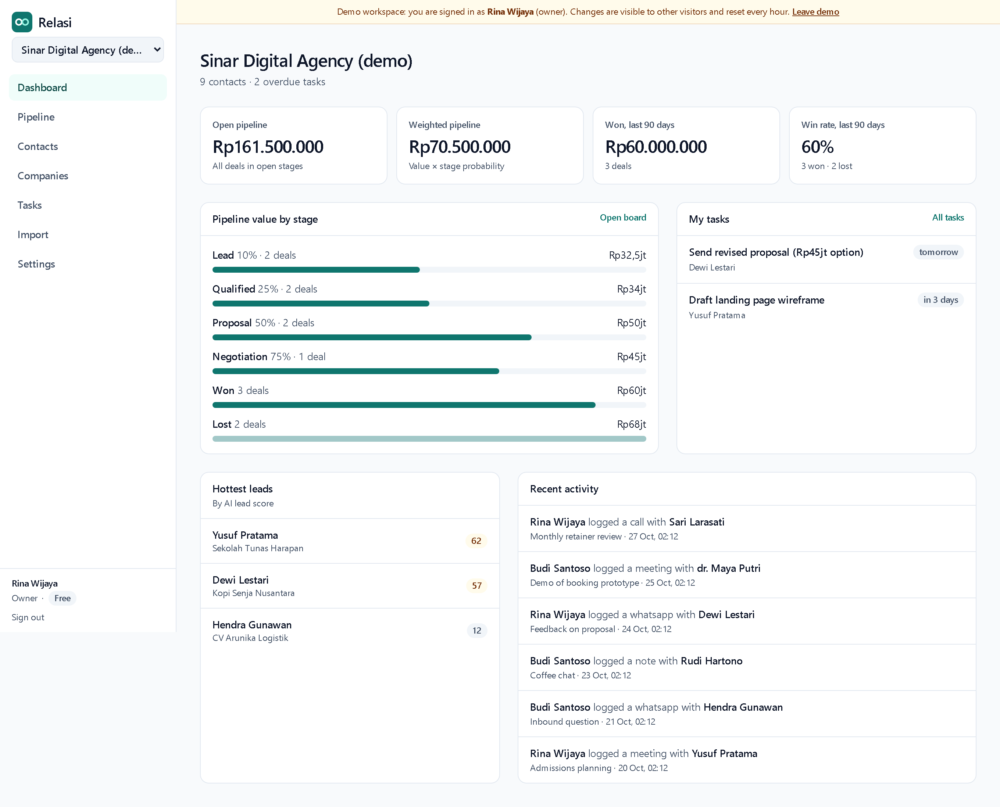
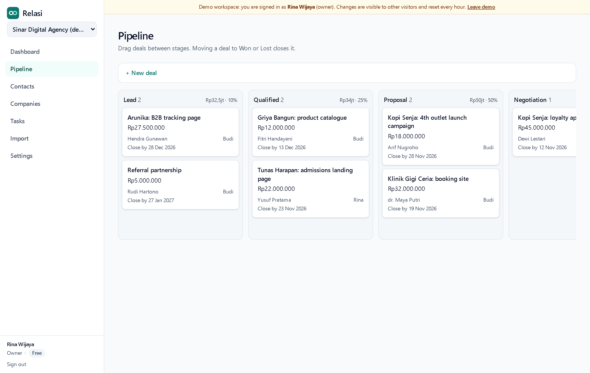
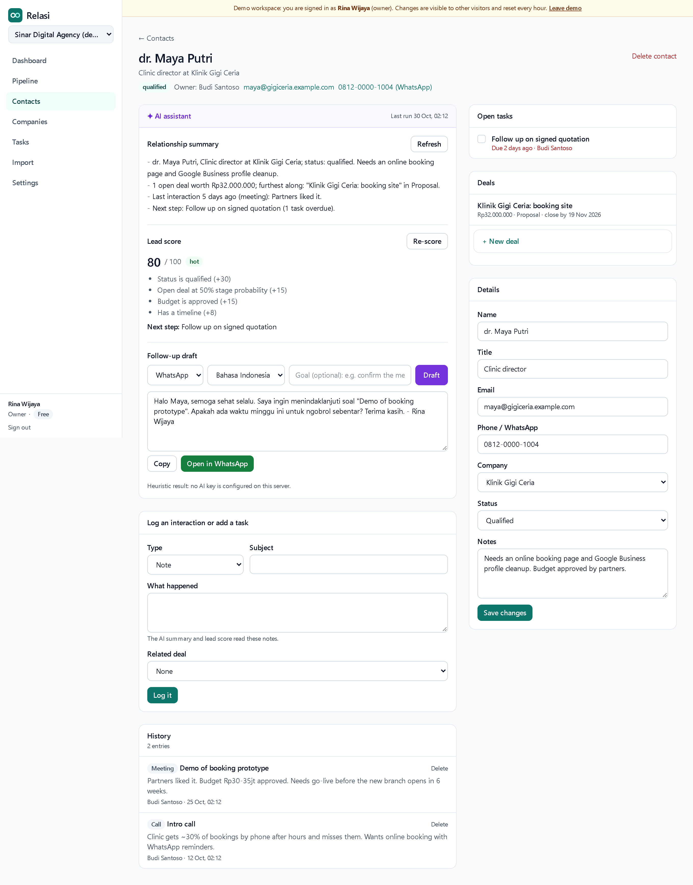
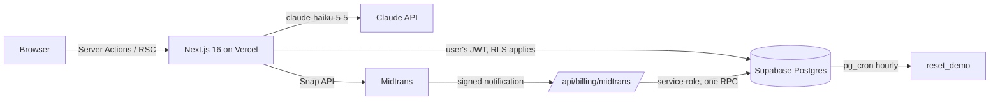

# Relasi: AI-powered CRM for small businesses

[](https://github.com/vacelni/relasi-crm/actions/workflows/ci.yml)

Relasi is a multi-tenant CRM for Indonesian small businesses (UMKM) and small agencies. A team keeps its contacts,
companies, deals, and follow-ups in one workspace, works the pipeline on a drag-and-drop board, and uses Claude to
summarize each relationship, score leads with reasons, draft the next WhatsApp or email message, and turn pasted
business cards or chats into contacts.

**Live demo:** _coming soon_ · sign in with one click as the owner or as a sales rep (data resets every hour).



| Pipeline board | Contact with the AI assistant |
| --- | --- |
|  |  |

## Features

- **Workspaces and roles.** Sign up, create a workspace, invite teammates by link. Roles are `owner`, `admin`, and
  `sales`, enforced by Postgres row-level security, not by the UI.
- **Contacts and companies** with search, filters, owners, and status (lead → qualified → customer).
- **Pipeline board.** Drag deals between stages (mouse or touch). Moving a deal to Won or Lost closes it.
  Sales reps can only move their own deals; the board shows teammates' deals as read-only.
- **Activities and reminders.** Log calls, meetings, WhatsApp chats, and notes; add tasks with due dates; see what
  is overdue on the dashboard and the tasks page.
- **Dashboard:** open and weighted pipeline, revenue won and win rate over 90 days, value per stage.
- **CSV import** with header detection in English and Indonesian (`Nama`, `No HP`, `Perusahaan`…), a column mapper,
  per-line validation, and duplicate skipping.
- **AI assistant** (Claude Haiku):
  - relationship summary from the whole interaction history,
  - lead score from 0 to 100 with the evidence behind it and a next step,
  - follow-up draft for WhatsApp or email, in Bahasa Indonesia or English, with one-click "Open in WhatsApp",
  - contact extraction from pasted text (structured output), reviewed before anything is saved.
- **Plans and billing.** Free (3 seats, 30 AI calls a day) and Pro (25 seats, 500 a day), paid through Midtrans Snap
  in sandbox mode.
- **Audit log** of every change to contacts, companies, deals, stages, and memberships (admins only).

## Architecture



- **Next.js App Router** with Server Components for reads and Server Actions for writes. The browser never talks to
  Supabase or Claude directly, so the CSP allows `connect-src 'self'` only.
- **Supabase** for Postgres and auth. Every query runs as the signed-in user, so RLS decides what each one returns.
  The service-role key is used in exactly one place: the payment webhook.
- **Business rules live in the database** where they must hold for every client: seat limits, AI quotas, prices,
  invitation acceptance, role changes, and the payment state machine are SQL functions, covered by pgTAP tests.

### Security model

| | owner | admin | sales | other workspaces |
| --- | :-: | :-: | :-: | :-: |
| Read contacts, deals, activities | ✓ | ✓ | ✓ | ✗ |
| Edit records they own | ✓ | ✓ | ✓ | ✗ |
| Edit or delete anyone's records | ✓ | ✓ | ✗ | ✗ |
| Pipeline stages, invitations, audit log | ✓ | ✓ | ✗ | ✗ |
| Change roles, billing | ✓ | ✗ | ✗ | ✗ |

- Column-level grants: `org_id` cannot be changed by an `UPDATE`, and AI columns are written only through an RPC.
- Composite foreign keys `(id, org_id)` make cross-tenant references impossible even if a policy were wrong.
- Guard triggers do not leak information to callers the policies will reject (no "seat limit reached" for a
  non-admin, no member list for an outsider).
- New tables and functions get no client privileges by default (`alter default privileges ... revoke`), so a
  forgotten grant fails closed. A pgTAP test caught exactly this for the payment function during development.
- Security headers (CSP, HSTS, `frame-ancestors 'none'`, Permissions-Policy) in [`next.config.ts`](next.config.ts);
  the build refuses a secret key in a `NEXT_PUBLIC_` variable ([`lib/env.ts`](lib/env.ts)).
- Midtrans notifications are verified with the SHA-512 signature (constant-time compare), and the paid amount must
  match the order the database priced.

### AI design

- **Model:** `claude-haiku-5-5` at low effort. These are single-step tasks, and a cheap model keeps a free-plan quota
  affordable.
- **Structured outputs** for the lead score, follow-up draft, and extraction: the request carries the JSON schema
  generated from Zod, and the answer is validated again before use ([`lib/ai/schemas.ts`](lib/ai/schemas.ts)).
- **Prompt injection:** CRM text is user-written, so it goes inside tags, angle brackets in it are neutralized, and
  the system prompt says to treat it as data ([`lib/ai/prompts.ts`](lib/ai/prompts.ts)).
- **Per-tenant rate limits** in Postgres: `consume_ai_quota()` reserves a call under an advisory lock (daily plan
  quota plus 8 calls a minute per user) before Claude is called; token usage is recorded afterwards.
- **Works without a key.** With no `ANTHROPIC_API_KEY`, every feature falls back to deterministic heuristics
  ([`lib/ai/heuristics.ts`](lib/ai/heuristics.ts)), and the UI says which engine produced a result.
- Refusals, truncation, rate limits, and auth errors become user-facing messages
  ([`lib/ai/claude.ts`](lib/ai/claude.ts)).

## Testing

| Layer | Tool | What it covers |
| --- | --- | --- |
| Unit | Vitest (52 tests) | CSV parsing and mapping, rupiah parsing, form schemas, prompts, heuristics, Midtrans signatures, the Claude client against a stub API |
| Database | pgTAP (46 tests) | RLS on every table, tenant isolation, each role's permissions, grants, invitations, seat limits, AI quota, billing guards, demo guards |
| End to end | Playwright (9 tests) | demo as owner and as sales, drag and drop, AI features, sign-up → workspace → contact → CSV import → invitation → teammate joins, 404 across tenants |

CI runs all three on every push ([`.github/workflows/ci.yml`](.github/workflows/ci.yml)).

## Run it locally

Requirements: Node 24, Docker.

```bash
npm install
npx supabase start            # Postgres + auth on ports 553xx, applies migrations and the demo seed
cp .env.example .env.local    # then paste the publishable key from `npx supabase status`
npm run dev                   # http://localhost:3000
```

Sign in with **Demo as owner** or **Demo as sales**, or create an account (email confirmation is off locally).

```bash
npm run lint && npm run typecheck && npm test   # static checks and unit tests
npm run test:db                                 # pgTAP
npm run test:e2e                                # Playwright (builds and starts the app)
```

Optional: set `ANTHROPIC_API_KEY` to use Claude instead of the heuristics, and Midtrans sandbox keys to try checkout.

## Deploy

1. Create a Supabase project, then `npx supabase link` and `npx supabase db push`. Run
   [`supabase/demo/schedule.sql`](supabase/demo/schedule.sql) once in the SQL editor for the hourly demo reset, and
   `select public.reset_demo();` to create the demo workspace now.
2. In Supabase Auth settings, set the site URL and add `https://<your-domain>/auth/confirm` to the redirect URLs.
3. Deploy to Vercel with the variables from [`.env.example`](.env.example). `SUPABASE_SECRET_KEY`,
   `ANTHROPIC_API_KEY`, and `MIDTRANS_SERVER_KEY` are server-only.
4. In the Midtrans dashboard, set the payment notification URL to `https://<your-domain>/api/billing/midtrans`.

## Project layout

```
app/                  routes: landing, auth, onboarding, /o/[orgId]/… workspace pages, payment webhook
features/<domain>/    Server Actions (auth, orgs, contacts, deals, activities, ai, billing)
lib/                  pure logic (csv, format, validation, midtrans, ai/*) and Supabase clients
supabase/migrations/  schema, access control (RLS, grants, RPCs), demo workspace
supabase/tests/       pgTAP
tests/e2e/            Playwright
```

## What I would do next

- Email and WhatsApp reminders for due tasks (a scheduled job instead of in-app only).
- Custom fields and pipelines per workspace.
- Evals for the AI features on a labelled set of contacts, to compare prompts and models with numbers.

## License

MIT. Built by [Vacelnino Faiz Fadeli](https://github.com/vacelni).
